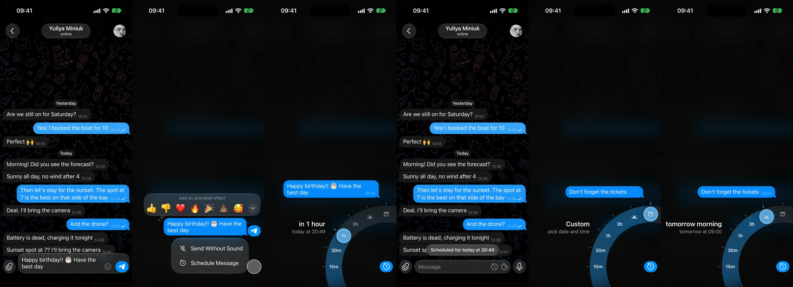

# Schedule by Dial

Hold Send and slide off it: a dial of send times grows around your thumb. Let go on "1h" and the message flies into
the scheduled-messages clock. One gesture instead of menu → calendar → button.

**Demo video:** [`media/demo.mp4`](media/demo.mp4)

## Why

Scheduling a message today takes four steps: hold Send, tap Schedule Message, set a day and a time on the calendar and
the wheel, tap Send. Most schedules are "in an hour" or "tomorrow morning", and those still go through the calendar.

## What it does

1. **Hold Send.** Telegram's send-options screen opens exactly as it does today: the screen blurs, the text turns into
   a bubble in place, "Add an animated effect" above, "Send Without Sound / Schedule Message" below. Let go without
   moving and it stays open, as today.
2. **Slide off Send, up or to the left.** The menu and the effects step aside and a dial grows around Send: 15m, 30m,
   1h, 3h, tonight (while there is time before 21:00), tomorrow morning, and Custom. Sliding down toward the menu still
   picks menu items, as today.
3. **Slide along it.** The knob clings to each stop and clicks into it with a tap of haptics. The bubble moves above
   the dial and shows the time it will go out, the way a scheduled message does. Left of the ring, out from under the
   thumb, the hint says it in words: *in 1 hour, today at 20:49*. Only the characters that change roll, like a
   numeric content transition.
4. **Let go.** The bubble dives into the scheduled-messages clock in the field and a toast confirms the time.
5. **Custom** opens the same date and time sheet as Schedule Message, so no moment is out of reach.
6. **Back over Send** and the menu returns, so the dial costs nothing to try.

Nothing here replaces existing UI: the send-options screen, its menu, the schedule sheet and the clock in the field are
Telegram's own, with sizes taken from the source. The concept adds the dial and the motion between them.

## Edge cases

- **Day and night themes**: the ring, the scale and the hint follow the theme's colors; the bubble keeps the theme's
  outgoing style (Night's gradient included).
- **Keyboard up or down**: today's screen moves up when the menu wouldn't fit below Send. Once the dial opens, Send
  goes back under the finger, so the ring is always centered where the thumb is.
- **Tonight** is offered only while 21:00 is more than three and a half hours away; later the ring has one stop fewer.
- **Not covered by the demo:** reduced motion (would crossfade instead of the flight), very long messages (the bubble
  would need to scroll or shrink above the ring), left-handed and RTL layouts (the dial would mirror), iPad, and
  chats where scheduling is unavailable (the dial simply wouldn't open).

## How it works

| Piece | Where |
| --- | --- |
| Hooking into the send-options screen: the held finger, the switch between menu and dial, the flight into the clock | `Feature/ScheduleDialFeature.swift` |
| The dial: ring fading past its ends, scale, knob with detents, the hint | `Feature/DialView.swift` |
| Rolling text, a UIKit take on SwiftUI's numeric content transition | `Feature/RollingLabel.swift` |
| The stops and how they are worded | `Feature/ScheduleStops.swift` |
| Hands-free demo playback with a drawn finger | `Feature/ScheduleDialFeature.swift`, `Feature/ScenarioFingers.swift` |
| Telegram's chat screen, send-options screen and schedule sheet, rebuilt in plain UIKit for the demo | `Vendor/TelegramShell` |

**Where it goes in Telegram-iOS.**

- `ChatSendMessageContextScreen`: the send-options screen. Its finger tracking (the drag-to-select over the menu) is
  where the dial takes over once the finger leaves Send upward or to the left.
- `ChatTextInputActionButtonsNode`: Send and its long press, unchanged.
- `ChatControllerImpl`: the scheduled-message send path, called with the picked time instead of going through
  `presentScheduleTimePicker`; Custom calls `presentScheduleTimePicker` as Schedule Message does today.

## Run

Open `ScheduleDial.xcodeproj`, pick an iPhone simulator and Run. No dependencies; UIKit, iOS 26+.
Launch with `-scenario` to play the demo hands-free, with a drawn finger: a birthday message goes out in an hour, then
a second one sweeps to Custom and back to tomorrow morning
(`xcrun simctl launch booted concept.schedule-dial -scenario`). The demo runs in the dark theme; launch with `-light`
to follow the system appearance.

---

The chat screen is transcribed from [Telegram-iOS](https://github.com/TelegramMessenger/Telegram-iOS) (GPL-2.0). This is a UX prototype, not a client.

